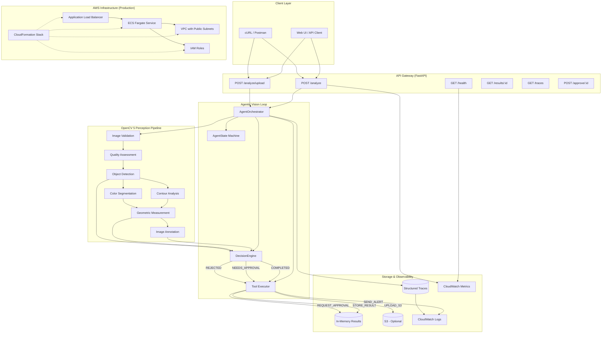

# VisionPilot Architecture Diagram

## System Overview



## Component Details

### 1. OpenCV 5 Perception Pipeline (`visionpilot/core/pipeline.py`)

```
Input Image (bytes)
       │
       ▼
┌──────────────────┐
│  imdecode        │ ─── Invalid? ──▶ REJECT
└────────┬─────────┘
         │
         ▼
┌──────────────────┐
│  Quality Check   │ ─── Score < 0.3 ──▶ REJECT
│  • Laplacian     │
│  • Brightness    │
└────────┬─────────┘
         │
         ▼
┌──────────────────┐
│  Detect Objects  │
│  ┌────────────┐  │
│  │ Contours   │  │
│  │ (Canny +   │  │
│  │ findContours)│
│  └────────────┘  │
│  ┌────────────┐  │
│  │ Colors     │  │
│  │ (HSV +     │  │
│  │ inRange)   │  │
│  └────────────┘  │
└────────┬─────────┘
         │
         ▼
┌──────────────────┐
│  Measurements    │
│  • Bounding box  │
│  • Centroids     │
│  • Distances     │
└────────┬─────────┘
         │
         ▼
┌──────────────────┐
│  Annotate Image  │
│  (base64 PNG)    │
└──────────────────┘
```

### 2. Agent Orchestration (`visionpilot/agent/orchestrator.py`)

```
Request Received
       │
       ▼
┌──────────────────┐
│  TRACE:          │
│  request_received│
└────────┬─────────┘
         │
         ▼
┌──────────────────┐
│  Vision Pipeline │
│  (perception)    │
└────────┬─────────┘
         │
         ▼
┌──────────────────┐
│  Decision Engine │
│  (rule eval)     │
└────────┬─────────┘
         │
         ▼
    ┌────┴────┐
    │         │
 COMPLETED  NEEDS_APPROVAL
    │         │
    ▼         ▼
┌───────┐ ┌───────────┐
│ TOOL: │ │ TOOL:     │
│ STORE │ │ REQUEST_  │
│ RESULT│ │ APPROVAL  │
└───┬───┘ └─────┬─────┘
    │           │
    ▼           ▼
┌──────────────────┐
│  TRACE:          │
│  final_outcome   │
└──────────────────┘
```

### 3. Decision Rules Priority Flow

```
Priority 100: REJECT_INVALID
    │
    ▼ (if valid)
Priority 95:  REJECT_BLURRY
    │
    ▼ (if quality ≥ 0.3)
Priority 90:  NO_DETECTIONS
    │         │
    │         ▼ (quality good)
    │    ┌─────────┐
    │    │ COMPLETE │
    │    │ (empty)  │
    │    └─────────┘
    │
    ▼ (if detections exist)
Priority 80:  LOW_CONFIDENCE
    │         │
    ▼         ▼
APPROVAL  (if max conf < 0.9)
    │
    ▼ (if max conf ≥ 0.9)
Priority 70:  GOOD_DETECTIONS ──▶ COMPLETE
    │
    ▼ (if mixed)
Priority 60:  MIXED_QUALITY
    │
    ▼ (if crowded)
Priority 50:  CROWDED_SCENE ──▶ COMPLETE
```

### 4. API Endpoints

| Method | Path | Description |
|--------|------|-------------|
| GET | /health | Health check with OpenCV version |
| GET | / | API information |
| POST | /analyze | Base64 image analysis |
| POST | /analyze/upload | Multipart file upload |
| GET | /results/{id} | Retrieve stored result |
| GET | /traces | Get recent agent traces |
| GET | /demo | List demo inputs |
| POST | /approve/{id} | Respond to approval |

### 5. Data Flow

```
┌─────────────────────────────────────────────────────────────────┐
│                     REQUEST FLOW                                 │
├─────────────────────────────────────────────────────────────────┤
│                                                                 │
│  Client                                                         │
│    │                                                            │
│    │ POST /analyze {image_data, filename}                      │
│    ▼                                                            │
│  FastAPI (server.py)                                           │
│    │                                                            │
│    │ base64 decode                                              │
│    ▼                                                            │
│  Orchestrator.process_image()                                   │
│    │                                                            │
│    ├─▶ Trace: request_received                                 │
│    │                                                            │
│    ├─▶ VisionPipeline.process_request()                        │
│    │     │                                                     │
│    │     ├─▶ validate_image() ──▶ Trace: validation           │
│    │     │                                                     │
│    │     ├─▶ detect_objects() ──▶ Trace: detection            │
│    │     │      ├─▶ Canny + contours                          │
│    │     │      └─▶ HSV color segmentation                    │
│    │     │                                                     │
│    │     ├─▶ measure_*() ──▶ Trace: measurement              │
│    │     │                                                     │
│    │     └─▶ create_annotated_image()                         │
│    │                                                            │
│    ├─▶ DecisionEngine.decide()                                 │
│    │     │                                                     │
│    │     ├─▶ Evaluate rules (priority order)                  │
│    │     └─▶ Trace: decision                                  │
│    │                                                            │
│    ├─▶ ToolExecutor.invoke()                                   │
│    │     └─▶ Trace: tool_result                                │
│    │                                                            │
│    └─▶ Trace: final_outcome                                    │
│                                                                 │
│  Response: {outcome, decision, detections, traces}             │
│                                                                 │
└─────────────────────────────────────────────────────────────────┘
```

## Deployment Topology

```
┌────────────────────────────────────────────────────────────────┐
│                      PRODUCTION AWS                              │
│                                                                  │
│  ┌──────────────────────────────────────────────────────────┐  │
│  │                      VPC (10.0.0.0/16)                    │  │
│  │                                                          │  │
│  │  ┌──────────────┐     ┌──────────────┐                   │  │
│  │  │ Public Subnet│     │ Public Subnet│                   │  │
│  │  │ 10.0.1.0/24  │     │ 10.0.2.0/24  │                   │  │
│  │  │   (AZ-a)     │     │   (AZ-b)     │                   │  │
│  │  │              │     │              │                   │  │
│  │  │ ┌──────────┐ │     │ ┌──────────┐ │                   │  │
│  │  │ │ Task 1   │ │     │ │ Task 2   │ │                   │  │
│  │  │ │ Fargate  │ │     │ │ Fargate  │ │                   │  │
│  │  │ │ 1vCPU/2G │ │     │ │ 1vCPU/2G │ │                   │  │
│  │  │ └──────────┘ │     │ └──────────┘ │                   │  │
│  │  └──────┬───────┘     └──────┬───────┘                   │  │
│  │         │                    │                           │  │
│  └─────────┼────────────────────┼───────────────────────────┘  │
│            │                    │                               │
│            ▼                    ▼                               │
│  ┌──────────────────────────────────────────────┐              │
│  │          Application Load Balancer            │              │
│  │  Port 80 → Target Group (port 8000)           │              │
│  │  Health Check: GET /health                    │              │
│  └──────────────────────────────────────────────┘              │
│                              │                                  │
│                              ▼                                  │
│  ┌──────────────────────────────────────────────┐              │
│  │            CloudWatch Logs                    │              │
│  │  /ecs/visionpilot (14-day retention)         │              │
│  └──────────────────────────────────────────────┘              │
│                              │                                  │
│                              ▼                                  │
│  ┌──────────────────────────────────────────────┐              │
│  │            IAM Roles                          │              │
│  │  • ECS Execution Role (logs, ECR)            │              │
│  │  • Task Role (S3 read/write for uploads)     │              │
│  └──────────────────────────────────────────────┘              │
│                                                                  │
└────────────────────────────────────────────────────────────────┘
```