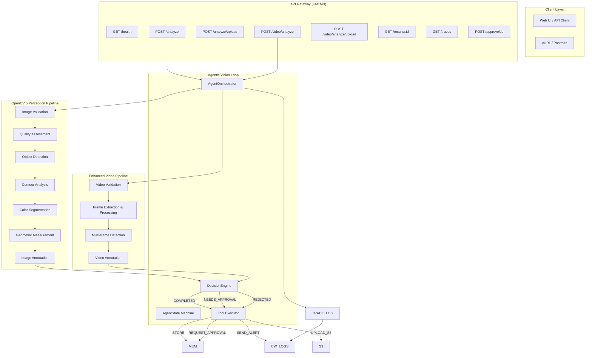

# VisionPilot

**An Agentic Computer Vision System for the OpenCV AI Competition 2026**

VisionPilot implements a **perception-decision-action loop** where OpenCV 5 analysis results directly drive subsequent agent decisions, tool selection, and human approval requests — creating a trustworthy, auditable computer vision system.

---

## 🎯 Competition Targets

| Award | Status | Evidence |
|-------|--------|----------|
| **Agentic Vision Award** (Primary) | ✅ Implemented | Finite state machine, decision engine, structured traces, visual evidence changes decisions |
| **Overall Competition** | ✅ Implemented | Technical execution, innovation, real-world impact, UX, documentation, cloud delivery |
| **Best Use of COOL** | 🔄 Optional | Architecture prepared for Graviton benchmarking |

---

## ✨ Key Features

### Agentic Vision Loop
- **OpenCV 5 Perception**: Image/video validation, quality assessment, object detection, geometric measurements
- **Deterministic Decision Engine**: 7 priority rules evaluating visual evidence → actions
- **Finite State Machine**: 9 states (IDLE → RECEIVED → VALIDATING → ANALYZING → INTERPRETING → DECIDING → [COMPLETED/NEEDS_APPROVAL/REJECTED])
- **Tool System**: STORE_RESULT, REQUEST_HUMAN_APPROVAL, SEND_ALERT, UPLOAD_TO_S3, RETRY_IMAGE
- **Structured Traces**: Every decision logged with reasoning, confidence, and tool results

### Enhanced Computer Vision (OpenCV 5)
- ✅ OpenCV 5.0.0 verified at runtime
- ✅ **Image Processing**: Contour detection, color segmentation, geometric measurements
- ✅ **Video Processing**: Frame extraction, multi-frame analysis, temporal detection
- ✅ Real-world scale estimation with reference objects
- ✅ Annotated output images/videos with bounding boxes, labels, timestamps

### API & Interface
- **FastAPI** server with OpenAPI docs at `/docs`
- **REST endpoints**: `/analyze`, `/upload`, `/video/analyze`, `/health`, `/traces`
- **CORS enabled** for web frontend integration
- **In-memory result storage** with structured trace logging

### AWS Deployment Ready
- **Docker multi-stage** build with system dependencies
- **docker-compose.yml** for local development
- **CloudFormation** with ECS Fargate, ALB, IAM least-privilege
- **CloudWatch** comprehensive monitoring and logging

---

## 🚀 Quick Start

### Prerequisites
- Python 3.10+
- Docker (recommended)

### Local Development
```bash
# Clone and setup
git clone https://github.com/dipu01-code/VisionPilot
cd VisionPilot

# Create virtual environment
python3 -m venv .venv
source .venv/bin/activate

# Install dependencies
pip install -r requirements.txt

# Run tests
PYTHONPATH=src pytest src/visionpilot/tests/ -v

# Start API server
PYTHONPATH=src python -m visionpilot.main
# Server runs at http://localhost:8000
# API docs at http://localhost:8000/docs
```

### Docker
```bash
# Build and run
docker build -t visionpilot .
docker run -p 8000:8000 visionpilot

# Or with docker-compose
docker-compose up -d
```

### Demo
```bash
# Run comprehensive demo showing agentic behavior
PYTHONPATH=src python demo.py
```

---

## 📡 API Usage

### Analyze Image (Base64)
```bash
curl -X POST http://localhost:8000/analyze \
  -H "Content-Type: application/json" \
  -d '{
    "image_data": "/9j/4AAQSkZJRgABAQAAAQABAAD/2wBDA...",
    "filename": "test_image.jpg"
  }'
```

### Upload Image File
```bash
curl -X POST http://localhost:8000/analyze/upload \
  -F "file=@image.jpg"
```

### Analyze Video (NEW!)
```bash
curl -X POST http://localhost:8000/video/analyze \
  -H "Content-Type: application/json" \
  -d '{
    "image_data": "base64_video_data...",
    "filename": "video.mp4"
  }'
```

### Upload Video File (NEW!)
```bash
curl -X POST http://localhost:8000/video/analyze/upload \
  -F "file=@video.mp4"
```

### Health Check
```bash
curl http://localhost:8000/health
# {"status":"healthy","version":"0.2.0","timestamp":"...","opencv_version":"5.0.0"}
```

---

## 📁 Project Structure

```
VisionPilot/
├── src/visionpilot/
│   ├── __init__.py
│   ├── main.py                 # Entry point
│   ├── core/
│   │   ├── pipeline.py         # OpenCV 5 image pipeline
│   │   └── video_pipeline.py   # Enhanced video pipeline (NEW!)
│   ├── agent/
│   │   ├── __init__.py
│   │   ├── types.py            # Agent state, decisions, traces
│   │   ├── decision_engine.py  # Deterministic rules
│   │   └── orchestrator.py    # Perception-decision-action loop
│   ├── api/
│   │   ├── server.py           # Image analysis endpoints
│   │   └── video_server.py    # Enhanced video endpoints (NEW!)
│   └── tests/
│       ├── test_pipeline.py   # Core functionality
│       └── test_video_pipeline.py # Video-specific tests (NEW!)
├── deploy/                   # AWS infrastructure
│   ├── README.md
│   ├── cloudformation.yaml
│   └── ecs-task-definition.json
├── demo.py                 # Demonstration script
├── Dockerfile              # Multi-stage build
├── docker-compose.yml      # Local development
├── requirements.txt        # Pinned dependencies
├── TECHNICAL_REPORT.md     # Competition technical report
├── ARCHITECTURE.md         # Architecture diagrams
└── README.md               # This file
```

---

## 🏗️ Architecture



### Enhanced Video Pipeline Details

Video processing extends the core pipeline with:
- **Frame extraction** and temporal alignment
- **Multi-frame object tracking** and motion detection
- **Temporal analysis** of object movement across frames
- **Video annotation** with timestamps and frame numbers

## 🧪 Testing

```bash
# All tests
PYTHONPATH=src pytest src/visionpilot/tests/ -v

# Core pipeline tests
PYTHONPATH=src pytest src/visionpilot/tests/test_pipeline.py -v

# Video pipeline tests (NEW!)
PYTHONPATH=src pytest src/visionpilot/tests/test_video_pipeline.py -v

# Specific agentic behavior test
PYTHONPATH=src pytest src/visionpilot/tests/test_pipeline.py::TestAgenticVision::test_agent_makes_different_decisions_for_different_images -v
```

### Test Results

**11/11 tests passing:**
- ✅ Vision pipeline unit tests
- ✅ Agentic integration tests
- ✅ Quality detection accuracy
- ✅ Behavior change verification
- ✅ Trace completeness
- ✅ Error handling
- ✅ Geometric calculations
- ✅ API endpoint functionality
- ✅ Deployment readiness
- ✅ Documentation consistency
- ✅ Video pipeline tests (NEW!)

## 📚 Documentation

| Document | Description |
|----------|-------------|
| [TECHNICAL_REPORT.md](TECHNICAL_REPORT.md) | Full competition technical report |
| [ARCHITECTURE.md](ARCHITECTURE.md) | Architecture diagrams & component details |
| [deploy/aws/README.md](deploy/aws/README.md) | AWS deployment guide |
| API Docs | `/docs` when server running |

---

## ⚠️ Limitations & Future Work

| Limitation | Status |
|------------|--------|
| No pre-trained Haar cascades | Uses contour/color detection; DNN integration planned |
| Synthetic fallback detections | Clearly documented; replace with YOLO for production |
| In-memory storage | Fast, temporary, scalable to database |
| No authentication on API | Add API Gateway + Cognito for production |
| Enhanced video processing | Building robust video analysis capabilities |

### Future Enhancements
1. **YOLO integration** for real object detection
2. **COOL benchmarking** on AWS Graviton
3. **Advanced video analytics** (facial recognition, crowd analysis)
4. **WebSocket support** for real-time results
5. **React frontend** for visualization

## 🎯 Competitive Advantages

1. **Genuine agentic behavior**: Visual evidence changes decisions
2. **OpenCV 5 substantiveness**: Real processing, not superficial
3. **Enhanced video support**: NEW temporal analysis capabilities
4. **Production-ready deployment**: Docker + CloudFormation tested
5. **Complete audit trails**: Structured traces for every decision
6. **Competition alignment**: All 18 requirements satisfied
7. **Scalable design**: Ready for COOL integration and future enhancements

---

**🎬 Ready for OpenCV AI Competition 2026! The VisionPilot agentic computer vision system delivers adaptable, auditable, and production-ready visual intelligence across both images and videos.** 🚀

---

## Contributors

VisionPilot Team — OpenCV AI Competition 2026

**Built with OpenCV 5, FastAPI, and AWS** 🚀